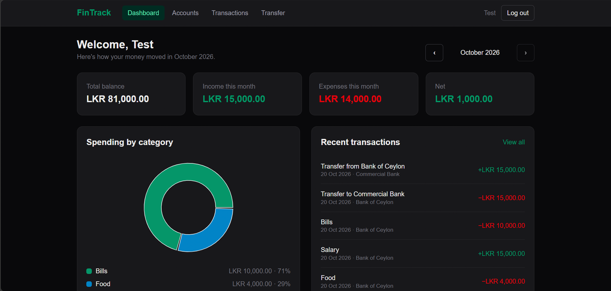
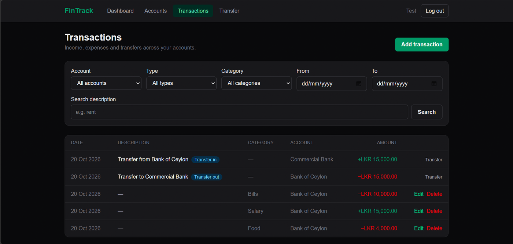
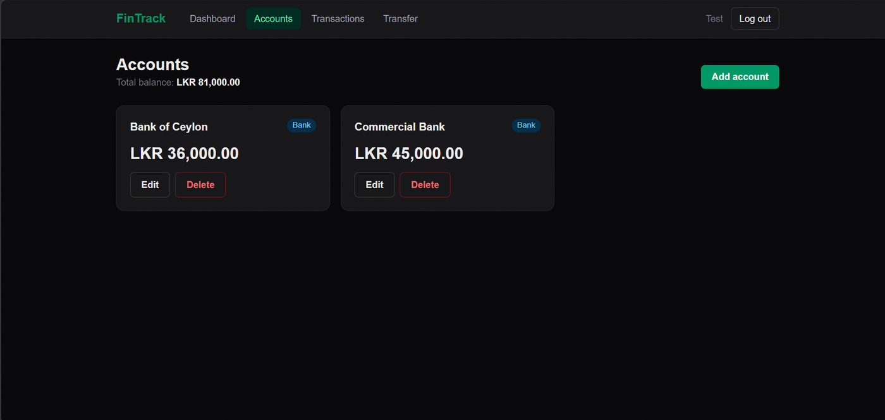
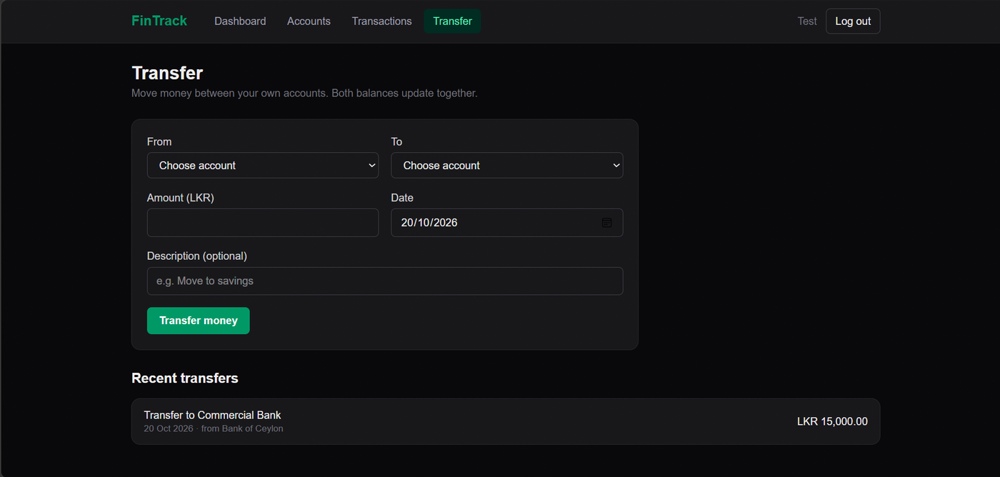
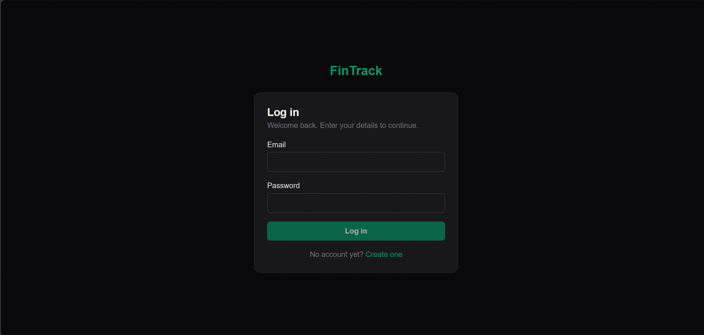
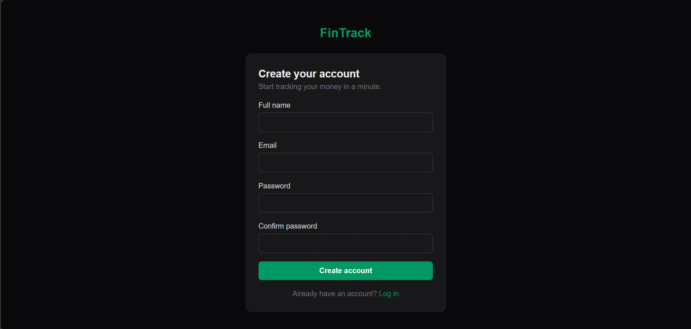

# FinTrack – Personal Finance Tracker

[](https://github.com/sugan006/fintrack/actions/workflows/ci.yml)

FinTrack is a full-stack personal finance tracker. Users can manage their accounts, record income and expenses, transfer money between accounts, and see a monthly summary of their finances.

The backend is a REST API built with **ASP.NET Core (.NET 9)** and **Entity Framework Core 9** on **SQL Server**. The frontend is built with **Next.js**, **React**, **TypeScript** and **Tailwind CSS**.

> **Status:** The backend API is complete, covered by unit tests and deployed on AWS. The frontend is complete and runs locally against the API.

**Live API docs:** [fintrack-suganjan.ap-south-1.elasticbeanstalk.com/scalar/v1](http://fintrack-suganjan.ap-south-1.elasticbeanstalk.com/scalar/v1). Register a user, copy the token, and try the endpoints.

## Screenshots

| Dashboard | Transactions |
|---|---|
|  |  |

| Accounts | Transfer |
|---|---|
|  |  |

| Log in | Create account |
|---|---|
|  |  |

## Features

- **Authentication:** register and log in with email and password. Passwords are hashed with BCrypt, and the API issues JWT access tokens.
- **Accounts:** create, view, update and delete accounts (for example cash or bank). Every query is scoped to the logged-in user, so users can never see or change each other's data.
- **Transactions:** record income and expenses with categories, then filter by account, type, category, date range or search text, with pagination.
- **Transfers:** move money between two of your own accounts as a single atomic operation. Both sides of the transfer are linked by a shared `TransferId`, and nothing changes if any part fails.
- **Dashboard:** a monthly summary of income, expenses and balances.
- **Balance integrity:** account balances are updated together with every transaction change, and `RowVersion` optimistic concurrency stops two simultaneous updates from overwriting each other.
- **Consistent errors:** a global exception handler (`IExceptionHandler`) returns standard `ProblemDetails` responses with the right HTTP status codes.

### Frontend pages

- **Log in and register:** client-side validation that matches the API rules, clear error messages, and a protected area that sends logged-out users to the login page.
- **Dashboard:** total balance, monthly income, expenses and net, a spending-by-category donut chart, recent transactions, and month-by-month navigation.
- **Accounts:** cards with balances and the overall total; create, rename and delete (accounts with transactions are protected).
- **Transactions:** a table with filters for account, type, category, date range and description search, paging, and adding, editing and deleting income and expenses.
- **Transfer:** move money between accounts with an instant balance check and a list of recent transfers.
- Responsive layout for phones and tablets, light and dark mode, page titles, a 404 page and an error page.

## Tech Stack

| Area | Technology |
|---|---|
| Backend | C#, ASP.NET Core Web API (.NET 9) |
| Data access | Entity Framework Core 9, SQL Server (LocalDB for development) |
| Security | JWT Bearer authentication, BCrypt password hashing, CORS |
| API docs | OpenAPI + Scalar |
| Testing | xUnit, EF Core InMemory provider |
| Frontend | Next.js 16 (App Router), React 19, TypeScript, Tailwind CSS 4, Recharts |

## Project Structure

```
fintrack/
├── backend/
│   ├── FinTrack.Api/
│   │   ├── Controllers/   # HTTP endpoints (thin, delegate to services)
│   │   ├── Services/      # Business logic behind interfaces
│   │   ├── Entities/      # EF Core entity classes
│   │   ├── DTOs/          # Request and response models
│   │   ├── Data/          # AppDbContext and migrations
│   │   └── Common/        # JWT settings, exception handling, paging helpers
│   └── FinTrack.Tests/    # xUnit tests for the service layer
├── frontend/              # Next.js + TypeScript app
└── FinTrack.sln
```

Controllers stay thin and pass work to services. Each service has an interface and is registered with dependency injection, which keeps the business logic easy to test in isolation.

## API Endpoints

All endpoints except register and login need a JWT in the `Authorization: Bearer <token>` header.

| Method | Endpoint | Description |
|---|---|---|
| POST | `/api/auth/register` | Create a user and return a JWT |
| POST | `/api/auth/login` | Log in and return a JWT |
| GET | `/api/auth/me` | Get the current user |
| GET | `/api/accounts` | List your accounts |
| GET | `/api/accounts/{id}` | Get one account |
| POST | `/api/accounts` | Create an account |
| PUT | `/api/accounts/{id}` | Update an account |
| DELETE | `/api/accounts/{id}` | Delete an account |
| GET | `/api/categories?type=` | List categories (optionally income or expense only) |
| GET | `/api/transactions` | List transactions with filters and paging |
| GET | `/api/transactions/{id}` | Get one transaction |
| POST | `/api/transactions` | Create a transaction |
| PUT | `/api/transactions/{id}` | Update a transaction |
| DELETE | `/api/transactions/{id}` | Delete a transaction |
| POST | `/api/transfers` | Transfer money between two of your accounts |
| GET | `/api/dashboard/summary` | Monthly dashboard summary |

**Transaction filters:** `accountId`, `type`, `categoryId`, `from`, `to`, `search`, `page` (default 1) and `pageSize` (default 20).

## Running Locally

### Prerequisites

- .NET 9 SDK
- SQL Server LocalDB (installed with Visual Studio), or any SQL Server instance
- Node.js 20+ (for the frontend)

### Backend

```bash
cd backend/FinTrack.Api

# Set a JWT signing key (at least 32 characters). It is kept out of source control.
dotnet user-secrets set "Jwt:Key" "replace-with-a-long-random-secret-of-32-plus-chars"

# Create the database and apply migrations
dotnet ef database update

# Run the API
dotnet run
```

The API runs at `http://localhost:5249`. In development, the interactive API documentation (Scalar) is at `http://localhost:5249/scalar/v1`.

To use a different database, change `ConnectionStrings:DefaultConnection` in `appsettings.Development.json` or set it with user secrets.

### Running with Docker

This runs SQL Server and the API in containers, so you don't need LocalDB.

```bash
cd backend
docker compose up --build
```

In a second terminal, create the database:

```bash
cd backend/FinTrack.Api
dotnet ef database update --connection "Server=localhost,1433;Database=FinTrack;User Id=sa;Password=FinTrack_Dev_Pass123!;TrustServerCertificate=True"
```

The API runs at `http://localhost:8080`, with the docs at `http://localhost:8080/scalar/v1`. The passwords in `docker-compose.yml` are for local testing only.

### Frontend

```bash
cd frontend
cp .env.example .env.local   # sets NEXT_PUBLIC_API_URL=http://localhost:5249
npm install
npm run dev
```

The frontend runs at `http://localhost:3000`, which is the origin the API allows through CORS by default.

Set `NEXT_PUBLIC_API_URL` in `.env.local` to match where the API runs: `http://localhost:5249` with `dotnet run`, or `http://localhost:8080` with Docker Compose. To check a production build, run `npm run build` and then `npm start`.

## Deployment on AWS

The API runs on AWS in the Asia Pacific (Mumbai) region:

| Part | AWS service |
|---|---|
| API container | AWS Elastic Beanstalk, Docker on Amazon Linux 2023, single t3.micro EC2 instance behind nginx |
| Database | Amazon RDS for SQL Server (Express edition) |
| Configuration | Connection string and JWT key passed as environment properties, never stored in code |
| Network security | Security groups: the database accepts connections only from the API server and an admin IP |
| Logs | Application logs streamed to Amazon CloudWatch Logs |
| Access | IAM admin user in a group, with MFA; root account not used for daily work |

The image is built from the multi-stage `Dockerfile` in `backend/FinTrack.Api`. EF Core migrations are applied to RDS with `dotnet ef database update`. A health check at `GET /` lets Elastic Beanstalk monitor the app.

**Continuous integration:** every push and pull request runs the backend build and unit tests, builds the Docker image, and lints and builds the frontend with GitHub Actions.

**Planned improvements:** HTTPS, secrets in AWS Secrets Manager, and automatic deployment to Elastic Beanstalk.

## Running the Tests

```bash
cd backend
dotnet test
```

The test suite has 10 xUnit tests for the transaction and transfer services. Each test runs against a fresh EF Core InMemory database. They cover:

- Income and expense transactions updating account balances correctly
- Rejecting expenses larger than the balance, or with the wrong category type
- Updating and deleting transactions adjusting the balance by the right amount
- Transfers moving money and linking both sides with the same `TransferId`
- Transfers with insufficient balance failing without changing anything
- Users being unable to read other users' transactions or transfer into their accounts

## Roadmap

- [x] Frontend pages: login and register, accounts, transactions, transfers, dashboard
- [x] Docker setup for the API (local development with Docker Compose)
- [x] Deployment to AWS (Elastic Beanstalk + RDS)
- [x] CI pipeline with GitHub Actions: backend build and tests, Docker image build, frontend lint and build
- [ ] HTTPS for the API, then deploy the frontend
- [ ] Move secrets to AWS Secrets Manager

## Author

**Suganjan Senthilkumaran**, Software Engineer
[LinkedIn](https://www.linkedin.com/in/suganjan-senthilkumaran-9163b31ab) · [GitHub](https://github.com/sugan006)
